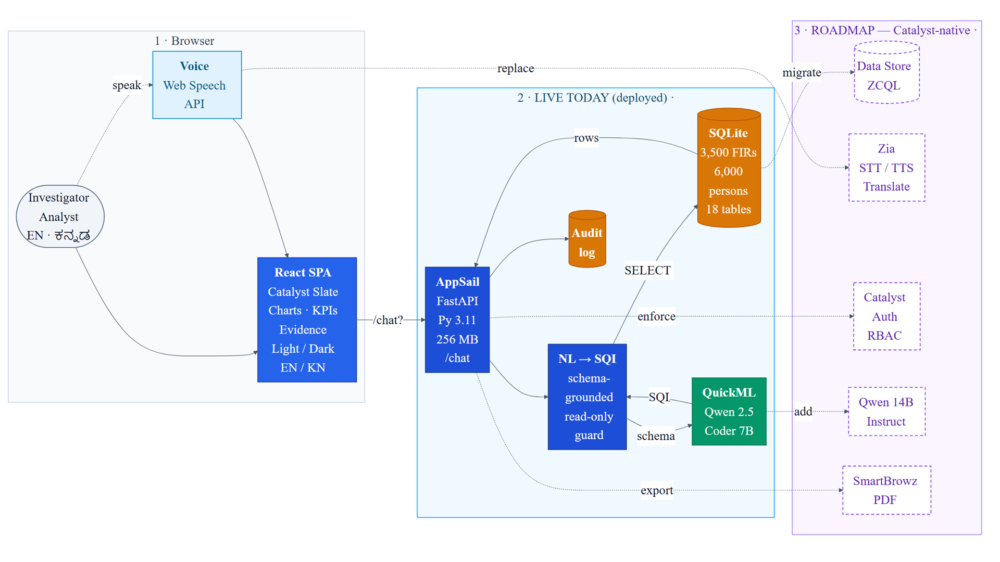

# Sahayak — Conversational AI for the KSP Crime Database

> **KSP Datathon 2026 · Challenge 01**
> Ask the Karnataka State Police crime database a question in plain **English or ಕನ್ನಡ** and
> get an answer **grounded in real records** — with the exact SQL and the source FIR rows
> attached to every response.

**Live demo:** https://sahayak-frontend-xpsqtdps.onslate.in
**Backend API:** https://sahayak-backend-50043102650.development.catalystappsail.in

*Sahayak* (ಸಹಾಯಕ, “assistant”) is built on one rule: **the model never invents a number.**
It writes a read-only SQL query, runs it on the actual FIRs, and shows its work.

---

## The problem (Challenge 01)

The State Crime Records Bureau holds crime data from 1,100+ stations across Karnataka, but
getting an answer means waiting on a data cell or staring at a static dashboard that can’t
answer ad-hoc questions. The July-2024 IPC→BNS legal-code switch silently breaks queries
that only know one code. Sahayak turns the whole database into a question box — and proves
every answer.

## What it does (live in the prototype)

- **Natural language → SQL** — Qwen 2.5 Coder 7B writes a read-only `SELECT`; a guardrail rejects any write.
- **Evidence trail** — every answer shows the exact SQL executed **and** the source FIR rows.
- **“Grounded · N records” badge** — shown only when real rows back the answer.
- **Audit log** — user, question, SQL, row count and role persisted on every query.
- **Auto visualisation** — bar / line / donut + KPI tiles, inferred from the result (hand-built SVG, no chart library).
- **IPC ↔ BNS cross-walk** — a mapping table lets one question span both legal codes across the 2024 transition.
- **Bilingual UI + voice** — English / ಕನ್ನಡ toggle and browser voice input (Web Speech API).
- **Multi-turn conversations** with per-chat history, and light/dark themes.

> Analyst tools — criminal-network, hotspots, time-trends and AI case summaries — are
> implemented on the backend API (`/tools/*`) and are the next to surface in the UI.

## Architecture



**Live request path:** Browser (React SPA on **Catalyst Slate**) → `GET /chat` → **Catalyst AppSail**
(FastAPI · Python 3.11 · 256 MB) → **Catalyst QuickML** (Qwen 2.5 Coder 7B) for NL→SQL → query runs on a
**bundled SQLite** database → answer + evidence returned. (`GET /chat` is used to bypass the Catalyst
proxy’s CORS preflight.)

**Roadmap (Catalyst-native):** migrate SQLite → Data Store/ZCQL · Zia for STT/TTS/translation ·
Catalyst Authentication enforcing the 4-role RBAC model · Qwen 14B Instruct for case summaries · SmartBrowz PDF export.

## Tech stack

| Layer | Tech |
|---|---|
| Frontend | React 18 · Vite · Axios · hand-built SVG charts · Web Speech API · Catalyst Slate |
| Backend | Python 3.11 · FastAPI · Uvicorn · Catalyst AppSail · read-only SQL guard · multi-turn session engine |
| AI | Qwen 2.5 Coder 7B (NL→SQL) via Catalyst QuickML; swappable `LLMProvider` (mock / ollama / catalyst-qwen) |
| Data | Bundled SQLite — 3,500 FIRs · 6,000 persons · 16 districts · 64 stations · IPC↔BNS mapping |

## Repo layout

```
data/        synthetic CCTNS-shaped dataset, generator, schema, ksp_crime.db
backend/     FastAPI app (api/), NL→SQL engine (engine/), analyst tools (tools/), eval harness (tests/)
frontend/    React + Vite chat SPA
functions/   Catalyst Basic I/O function variant of the API
docs/        architecture diagram, demo video script, submission assets
```

---

## Setup & run (local)

### Prerequisites
- Python 3.11+ and Node.js 18+
- Copy the env template and fill in your own values (see **Security** below):
  ```bash
  cp .env.example .env
  ```

### 1) Data (optional — a prebuilt `data/ksp_crime.db` is already included)
```bash
cd data
python -m pip install -r requirements.txt
python generate.py     # rebuilds data/ksp_crime.db
python verify.py       # prints summary stats
```

### 2) Backend (FastAPI)
```bash
python -m pip install fastapi uvicorn python-multipart
python -m uvicorn backend.api.main:app --host 0.0.0.0 --port 8000
```
- `LLM_PROVIDER` selects the model backend: `mock` (offline, default), `ollama-qwen` (local Qwen via Ollama), or `catalyst-qwen` (production).
- Health check: `GET http://localhost:8000/health`

### 3) Frontend (React + Vite)
```bash
cd frontend
npm install
npm run dev            # http://localhost:5173  (calls the backend on :8000 in dev)
npm run build          # production build for Catalyst Slate
```

### Evaluation
```bash
python -m backend.tests.eval_harness          # 12 canonical officer questions (mock, offline)
python -m backend.tests.eval_harness --live   # against Catalyst Qwen
```

## Deployment (Zoho Catalyst)
- **Frontend → Slate**, **Backend → AppSail**. See [DEPLOY_COMMANDS.md](DEPLOY_COMMANDS.md).
- All secrets (Zoho OAuth client id/secret, refresh token, QuickML endpoint) are provided to AppSail via
  **Catalyst Console → Environment Variables**, never committed to the repo.

## Security
- **Never commit credentials.** Real secrets live only in the Catalyst Console env vars and a local `.env`
  (git-ignored). `app-config.json` / `.env.example` should contain placeholders only.
- Database access is **read-only** at the query layer; write statements are rejected before execution.

## License
For the KSP Datathon 2026 submission. © 2026 Aditya Tayal.
